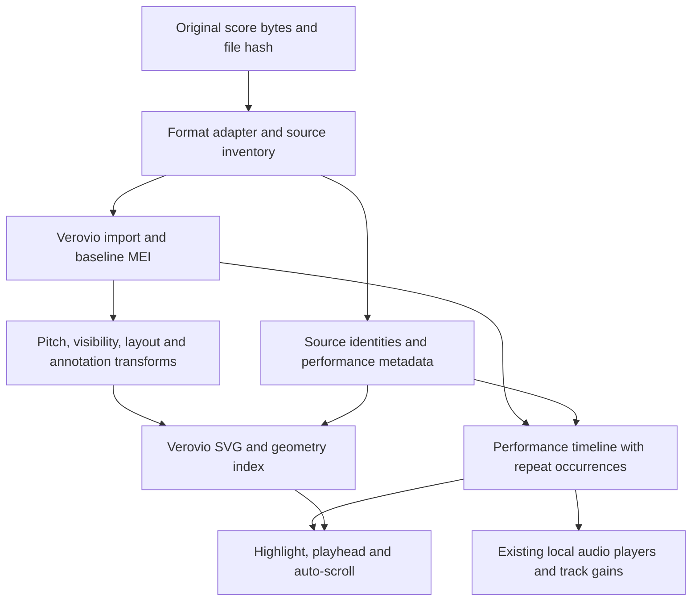

# Verovio migration plan

Date: 2026-09-29 · Status: **implemented 2026-09-30** — Verovio is the only renderer and VexFlow has been removed (commits `2cb61df`, `0147751`, `7a7334b`, `887b0b0`, `f65038b`). See [Implementation status](#implementation-status) for outcomes, evidence and open limitations. The plan text below is kept as written on 2026-09-29; statements that no longer hold are marked *[Stale 2026-09-30]*.
Branch: `plan/verovio-migration` · Base: `cc0f9fa7b9d5c49f25d5bd82ad3cf8af065f98f4`.

## Implementation status

Updated 2026-09-30 against `f65038b` (plus the test-only `96f80cf`). Verovio 6.3.0 is the sole renderer. Evidence below is limited to what the tracked validation suites assert and what the code does; anything else is marked untested. Upstream Verovio observations are collected separately in [verovio-upstream-notes.md](verovio-upstream-notes.md).

### Stage outcomes

| Stage | Outcome |
| --- | --- |
| 1. Baseline and feasibility | Done for feasibility: `verovio` 6.3.0 is pinned, and a Web Worker runs its WASM from the app's own bundle. Pre-migration screenshots, audio schedules and settings fixtures were **not** captured as committed baselines. |
| 2. Document and engine boundary | Done. `src/lib/notation/document.ts` holds immutable source documents: original text or bytes, SHA-256, engraving text, a source→note identity map, a feature inventory and diagnostics. Timewise MusicXML is normalized to partwise for engraving only, and MXL extraction is bounded (8 MB uncompressed). One worker toolkit handles requests serially, and renders carry generation IDs so superseded results are discarded. ABC, MIDI and the sample go through `scoreToMei`. No VexFlow bridge or engine flag was built (see stale note above). |
| 3. Reading parity | Done as covered by `validation/reader.mjs`. It checks Vertical 4 bars per line, Endless as one system, staff hiding and restore, controls aligned to their staves, note and count lanes, Petaluma, Mono text, the mixer and instrument picker, persisted state, a 320px top bar, preserving the previous score after a malformed import, and no remote requests. |
| 4. Pitch and performance parity | Done in `src/lib/playback/timeline.ts`. The timeline is built from the app's parsed `Score` plus the source MusicXML (for navigation, articulations and pedals), not from Verovio's timemap. There is an optional `verovioTimemap` cross-check, but the reader does not pass it. Transposition is applied once, in Verovio for engraving and in the timeline for sound. |
| 5. Coverage expansion | Partial. There are two tracked MusicXML fixtures (`validation/fixtures/ensemble.musicxml`, `expressive.musicxml`) plus inline cases in the scripts. The P0/P1 corpus in "Validation and completion criteria" is not complete, and P2 families were not systematically evaluated. |
| 6. Cutover | Done for renderer default, VexFlow removal and the README, including the Verovio LGPL notice. A performance comparison against the VexFlow baseline was not done (see Performance). |

### Tracked validation

- `npm run test:validation` runs three suites:
  - `validation/document.mjs`: source retention and hashing, timewise, MXL, MEI identity, the ABC→MEI adapter, drum-kit detection, MEI key/meter/accidental changes, the saved-BPM clamp and the MXL size bound.
  - `validation/performance.mjs`: 9 timeline fixtures and 33 review regressions.
  - `validation/reader.mjs`: the built `dist/` in Chromium.
- `npm run test:reader:firefox` and `npm run test:reader:webkit` run the reader suite in the other engines.
- CI in `.github/workflows/ci.yml` runs on every push and PR. It runs `check`, `build`, `test:manifest` and `test:validation` on Chromium, plus a matrix job that runs the reader suite in Firefox and WebKit.
- On 2026-09-30, `test:validation` and the Firefox reader suite passed locally. WebKit has only been validated in CI.
- `npm run test:example` (the Cielito integration check) is local-only because `tests/` and `examples/` are ignored.

### Capability ledger

Key:

- **verified**: a tracked assertion covers it.
- **partial**: some cases are asserted.
- **untested**: implemented or expected natively from Verovio, but not asserted.
- **no**: not implemented.
- **n/a**: not applicable.

"Source retained" is verified for every family: `document.mjs` asserts that the MusicXML/MEI text and the MXL bytes stay identical to the input, and nothing is rewritten.

| Priority / family | Imported | Engraved | Transposed | Performed |
| --- | --- | --- | --- | --- |
| P0 Rhythm and structure | partial: two voices, implicit pickup measure, all 160 ensemble pitches | partial: ABC triplets as MEI tuplets. MusicXML tuplets, grace/cue notes and beams untested | n/a | verified: tie chains, staggered graces, ABC triplets, silent cues, MIDI barline ties, mid-measure tempo. Nested tuplets untested |
| P0 Pitch and attributes | partial: MEI key, meter and accidental changes. MusicXML clef/key/time changes untested | untested beyond the sample | partial: sample +2 engraved exactly once; percussion never transposed. Written/concert view untested; unavailable for concert-pitch scores | verified for MEI accidental/key state |
| P0 Ties and slurs | verified for ties (per-pitch, across repeats and endings) | untested (no SVG tie/slur assertion) | n/a | verified: ties sustain without re-attack. Slurs are not interpreted |
| P0 Expression | verified: `<sound dynamics>`, symbol dynamics, staff/part scope, wedges | partial: native dynamics verified. Wedges and words untested | n/a | partial: dynamic precedence and scope, tempo map with hidden parts and anchored navigation words verified. Wedge interpolation (±22 velocity) implemented but not asserted |
| P0 Ensemble and percussion | verified: 5-part ensemble, unpitched notes, channel-10 kits, staff identity aliases across reloads | partial: staff count, hiding and control alignment verified. Braces, groups, cross-staff and percussion noteheads untested | percussion fixed (verified) | verified: default drum-kit mapping, drum channel. `midi-unpitched` mapping untested |
| P1 Text and harmony | partial: lyrics and source harmony parsed | partial: MusicXML lyrics (`.verse`) and the SMuFL tempo glyph verified. Harmony, rehearsal marks and multiple verses untested | untested for chord roots | n/a |
| P1 Navigation | verified from MusicXML source only (MEI/ABC repeats are not traversed) | untested | n/a | verified: repeats, nested repeats, 1st/2nd endings, D.S. al Fine/Coda (words, `<sound>` and glyphs), endings after D.C., timewise repeats, per-occurrence replay. On-screen occurrence highlighting untested |
| P1 Common markings | verified (via source note IDs) | partial: articulations (≥40 staccatos) verified. Fermatas, ornaments, tremolo, arpeggio and glissando untested | n/a | partial: staccato, tenuto, accents and fermata holds are implemented. Staccato and fermatas are asserted; accent velocity and tenuto are not. Ornaments, tremolo, arpeggio and glissando **no** (ornaments diagnosed) |
| P1 Extended spans | partial: pedal from source XML | untested | n/a | partial: damper pedal start/stop/change, `<sound damper-pedal>`, same-part scope and per-occurrence scope verified. Sostenuto **no** (diagnosed). Octave shifts untested |

### Known limitations

- Lyrics are drawn in Times whatever the text-font setting. Verovio computes lyric spacing from Times metrics, and wider faces collide (`src/styles.css`).
- Endless view is one unbroken system up to 160 bars. Longer scores are split into 120-bar chunks, and each chunk repeats its clef and key (`src/lib/render.ts`).
- The written (transposing) view is unavailable for scores encoded at concert pitch, because Verovio can only transpose written pitch to sounding pitch. Such scores always display at concert pitch.
- Ornaments and the sostenuto pedal are engraved but not synthesized. The timeline reports both in its diagnostics.
- Repeat and navigation playback reads MusicXML only. MEI, ABC and MIDI play straight through.
- The playback timeline does not use Verovio's timemap, so engraved and performed timing are not cross-checked at runtime.
- WebKit has been validated only in CI, not locally. Touch/pinch, 844×320 landscape and many-staff fit have no tracked assertions.

### Performance

Only first useful paint was measured, on 2026-09-30. Setup: production `dist/` served locally, headless Chromium 153, 390×844 viewport, i7-9750H under WSL2. Paint was timed from navigation until the loading overlay cleared and the first engraved note appeared.

| Measurement | Result |
| --- | --- |
| Default sample, cold (new browser profile) | 1.06–1.16 s over 3 runs |
| Default sample, warm (reload with HTTP cache) | 0.91–0.94 s |
| Import-to-paint for the 5-staff ensemble fixture | 0.60 s |
| Verovio worker chunk (WASM inlined) | 8.2 MB, uncompressed |

Not captured:

- a VexFlow baseline on the same profile, so the "no more than 20% regression" budget is **unevaluated**
- WASM load time separately from paint
- reflow time, memory and long tasks
- measurements on a phone

## Objective and baseline

Replace VexFlow with Verovio while retaining every current reader feature and preserving as much source MusicXML notation and performance information as practical. Keep the application browser-only, with local assets, local file import, and settings-only persistence. Source files must never be uploaded or silently rewritten.

This plan covers the current working tree, including pre-existing uncommitted changes to `src/lib/import.ts`, `render.ts`, and `score.ts`. Those changes add written durations, voices, grace/tuplet metadata, per-pitch accidentals/ties, directions, and changing measure attributes, with corresponding rendering work. Their presence is not proof of complete support. The existing `musicxml-fidelity-review.md` describes the earlier HEAD baseline; some findings have since been partially addressed. Reconcile each finding against fixtures before implementation, rather than treating that review as the current test result.

Prior product decisions were checked in GBrain `default:projects/scoreflow-music-reader` and compared with the current README and implementation. Current playback still schedules notes individually at velocity 82 with a 0.92 duration factor; it does not yet turn the new tie/direction metadata into a complete performance model. *[Stale 2026-09-30: playback now uses the unified timeline in `src/lib/playback/timeline.ts`; see Implementation status.]*

## Architecture decision

**Retain the original document and import MusicXML directly into Verovio.** Do not reconstruct MusicXML from the current `Score` model: that would lose the very source information this migration should recover.

Use three distinct representations:

1. **Source document:** immutable original bytes/text, original SHA-256 identity, format, metadata, and a source feature inventory. Retain unknown elements here even when Verovio cannot import them. For MXL, retain the archive identity and safely extract the declared score document.
2. **Engraving document:** Verovio's imported MEI plus controlled, reversible view transformations. Keep an untouched imported MEI baseline; derive each view from it so repeated transforms do not accumulate. MEI is a working representation, not a lossless archive of MusicXML.
3. **Application index and performance timeline:** source part/staff/voice/note identities, rational musical times, settings keys, rendered element references, diagnostics, and scheduled sounding events. Rendering, highlighting, and playback share the same identities. The current `Score` can remain an adapter for ABC/MIDI during transition, but must not constrain MusicXML fidelity.

Proposed flow:

Verovio documents direct MusicXML-to-MEI import, an optional Humdrum route, and basic MXL support. Start with the direct importer; benchmark the alternative only for a demonstrated conversion gap. MEI import can itself discard unsupported data, so preserve originals and collect diagnostics. [Input formats](https://book.verovio.org/toolkit-reference/input-formats.html)

### Format adapters

| Input | Planned path | Required compatibility |
| --- | --- | --- |
| MusicXML partwise | Original XML → Verovio | Source metadata, voices, staves, directions, spans and notation |
| MusicXML timewise | Try native input in the pinned build; otherwise loss-preserving timewise → partwise normalization | Measure attributes, namespaces, ordering, all parts and pickup labels |
| MXL | Existing `fflate` extraction adapted to a document loader → same XML path | Container rootfile selection, `.xml` and `.musicxml` members, actionable malformed-archive errors; preserve original-byte hash |
| MEI | Original MEI → Verovio directly | Avoid current reduced MEI parser; maintain imported identity and concert/written behavior |
| ABC files and paste | Keep `abcjs` semantics initially; serialize its existing model to MEI | Voices, explicit beams, dense lyric phrase behavior, chord symbols, tempo and current spelling |
| MIDI | Keep `@tonejs/midi` and sixteenth-note quantization; serialize to MEI | Tracks, rests, chords, durations spanning measures, percussion, existing settings keys |
| Default demo / `musicXml` prop | Demo → adapter; prop → direct XML document loader | Changing prop cancels audio/import/render jobs and resets playback; no encoding required |

Evaluate native ABC import later against the same compatibility fixtures. Do not assume Verovio accepts MIDI input because it exports MIDI.

### Renderer boundary and lifetime

Introduce an asynchronous renderer interface with `load`, `layout`, `render`, `getGeometry`, and `dispose`. During implementation, wrap VexFlow behind the same boundary and select the experimental Verovio engine with a development flag. Remove VexFlow only after the cutover gates pass. *[Stale 2026-09-30: no dual-engine flag was built. Verovio replaced VexFlow directly and the `vexflow` dependency was removed in `0147751`; rollback is the pre-migration commit `f10f340`/`cc0f9fa` with its lockfile.]*

Use a lazy, pinned npm release and locally served WASM/resources. The documented ESM entry points are `verovio/wasm` and `verovio/esm`. Confirm the actual release, wrapper signatures, assets, browser compatibility and license obligations in the first spike; do not depend on a moving CDN URL. [JavaScript/WASM integration](https://book.verovio.org/installing-or-building-from-sources/javascript-and-webassembly.html)

Prefer a worker owning one toolkit instance and serialized requests. Give every load/layout a generation ID; stale results must never replace the current score. Dispose replaced toolkits, workers, SVG listeners, and audio schedules. Retain the previous valid score if a load fails. Measure whether worker startup and transfer costs improve actual phone responsiveness.

Define a new geometry result containing systems, staff bounds, measures, and per-pitch note anchors. The existing `RenderResult` assumes mostly uniform system size and cannot be the permanent contract. Use SVG coordinate transforms and cached geometry after layout, never per-note DOM measurements on every animation frame. Scope DOM IDs by document/render generation while preserving the canonical Verovio ID mapping.

## Existing-feature parity contract

Each row is a cutover requirement, including behavior already present only in the working tree.

| Feature | Implementation route | Acceptance evidence |
| --- | --- | --- |
| White score surface, sticky transport, drawer, dialogs and loading transitions | Retain React shell and existing control styling; isolate renderer-specific code | Existing layout, menu layering, load errors and rapid-switch behavior at phone and desktop sizes |
| Vertical continuous reading | Stack rendered systems/pages without page furniture; retain natural musical spacing | Continuous scroll; short scores center; long scores start at top; source credits remain inside score |
| Auto and exact 1–4 bars per line | Auto caps systems at four; explicit choices insert view-only system breaks in MEI and scale as necessary | Requested measure counts, including pickup and final partial system; no accidental extra breaks or clipped notes |
| Endless horizontal reading | Prototype unbroken layout first; for large scores evaluate bounded horizontal system chunks | Continuous horizontal navigation, correct first-staff centering, span continuation, no first-bar/label overlap |
| Keyboard, page-turner, arrows and swipes | Keep handlers; derive viewport overlap from measured staffs/bars | Page Up/Down, arrows, Space, touch and overlap/off work in both views; focus in inputs remains usable |
| Zoom and many-staff fit | Preserve buttons, pinch, and initial full-stack fit for more than four playable staves | Stable geometry after zoom/resize; no blank view when changing orientation or mode |
| Bravura and Petaluma | Use Verovio font resources and selected font configuration | Both render all fixture glyphs; local asset loading, no external font request; document fallback glyphs |
| Sans/Serif/Mono score text | Style supported Verovio text and application annotations; configure metrics before engraving where needed | Names, counts, bar numbers, lyrics and chord labels switch with no collisions or clipped text |
| Note names, beat counts and subdivisions | Stable note anchors plus layout-aware annotation lanes or MEI annotations | Plain letters only; chord letters stacked highest first; counts below names; toggles survive reflow and font changes |
| Source and inferred chord symbols | Preserve timed source harmony; inference remains separately disabled by default | No duplicate labels; source wins; offset symbols need no coincident note; transpose roots and slash bass correctly |
| Lyrics | Native MusicXML/MEI lyrics; preserve existing ABC dense-phrase presentation through adapter | Multiple verses, syllables, melismas, and annotation lanes coexist |
| Titles, subtitles, composer, credits, part names and bar labels | Use source metadata once; first-system labels and icon gutter coordinated with SVG | No invented or duplicated credits; later Vertical systems reclaim first-system gutter |
| Hide/restore/reset staves | View transform with stable staff identity and corresponding audio mute | Existing more-than-four-staves controls and restore affordances; mixer lists hidden tracks; no loss of retained source data |
| Empty-staff filtering | Preserve initial omission of wholly silent templates as a reversible view policy | Unpitched percussion and meaningful cues/directions are not mistaken for empty staff; visible rests remain correct |
| Instrument icons, all 128 GM programs + Drum Kit, picker and mixer | Reuse manifest, local players, family filters, paging, track gain and metadata precedence | Both entry points work; exact sound survives shared icons and reload; instrument changes do not re-engrave |
| Playback, Pause/Stop, BPM, line, note highlights and follow-scroll | Shared performance timeline and SVG identity/geometry mapping | Simultaneous notes across all staves highlight; line spans current system; queued notes cancel; resumes correctly |
| ±12 semitones and written/concert view | Single pitch-transform policy, with separate displayed and sounding pitch | Notes, keys, source/inferred chords change; percussion fixed; no double transposition; controls persist |
| File state and portable envelope schemas | Preserve byte hash, mode names and existing settings; migrate staff IDs with explicit aliases | Version-1 saved fixtures restore view, fonts, zoom, BPM, pitch, sounds, volume and visibility; original source untouched |

The current MusicXML staff settings key is `${partId}-${staffNumber}`. Keep that alias even when Verovio chooses other element IDs. Map ABC/MIDI/MEI legacy keys explicitly. Unknown keys must not apply settings to an unrelated staff. Keep `portrait`/`landscape` persisted values behind the current Vertical/Endless labels.

Verovio exposes layout break and transposition controls, but exact reader behavior requires application policy and fixtures. Prototype encoded breaks, unbroken layout and sounding-pitch conversion before committing to their use. [Toolkit options](https://book.verovio.org/toolkit-reference/toolkit-options.html)

Bravura/Petaluma support must be checked in the selected WASM distribution. Existing VexFlow WOFF2 assets alone do not establish that Verovio has the required glyph resources. [Font resources](https://book.verovio.org/advanced-topics/smufl.html)

## MusicXML coverage targets

Maintain a fixture-backed capability ledger with separate columns for **source retained**, **imported**, **engraved**, **transposed**, and **performed**. Use verified / partial / unsupported / untested / not applicable, with toolkit version and fixture links. No row below is a claim of verified Verovio support in this repository. *[2026-09-30: the evidence-based ledger is in [Implementation status](#capability-ledger).]*

| Priority | Feature family | Cases and performance expectations |
| --- | --- | --- |
| P0 | Rhythm and structure | Exact divisions and rational onsets, backup/forward, concurrent voices, mixed-duration chords, rests/spacers, pickups, source measure labels, dots, explicit beams/hooks, stems, cue/grace notes, nested tuplets; no timing drift |
| P0 | Pitch and attributes | Clef/key/time changes including mid-measure, zero-fifths resets, accidentals/cautionaries, staff-specific and changing transposition, concert-score/for-part metadata; written vs sounding pitch explicit |
| P0 | Ties and slurs | Per-pitch ties, numbered slurs, overlapping voices and breaks across systems; ties sustain without repeated attacks, slurs remain distinct from ties |
| P0 | Expression | Composite and other-dynamics, above/below placement, voice/staff scope, words, numbered wedges and continuation; explicit sound dynamics and tempo honored |
| P0 | Ensemble and percussion | Part groups/braces/brackets, multistaff instruments, aligned beats, cross-staff notes/beams, unpitched display position, noteheads, instrument IDs and midi-unpitched mapping |
| P1 | Text and harmony | Multiple lyric verses, syllabic hyphens, elisions/melismas, rehearsal/tempo text, credits, harmony degrees/alterations/inversions, multiple offset symbols and fretboard frames |
| P1 | Navigation | Repeat/double/final barlines, numbered endings, segno/coda, D.C./D.S./Fine, repeat counts; bounded repeat traversal with correct occurrence highlights |
| P1 | Common markings | Articulations, fermatas, breath/caesura, ornaments, tremolo, arpeggiation and glissandi; distinguish engraved symbol from implemented sound interpretation |
| P1 | Extended spans | Pedal changes, octave shifts, dashed/bracket directions, continuation through system boundaries; pitch shifts and sustain cannot be applied twice |
| P2 | Specialized notation | Tablature, strings/frets/fingering, bends, scordatura, alternate staff lines/tunings, microtones, nonstandard keys/meters, ossias, multi-measure rests, measure-repeat symbols |
| P2 | Source presentation | Print visibility, cue sizing, colors, source break hints and positioning, embedded images and typography; semantic preservation takes priority over matching a printed page pixel for pixel |

P0 and P1 are the intended migration scope. Investigate every P2 family and implement supported cases; unsupported cases remain explicitly listed with source locations and a reason. Existing behavior is always P0 regardless of the table's grouping. A P0 failure blocks default cutover. Any proposed P1 deferral must be made explicit in the implementation review, not silently counted as support.

For every gap, try in order: direct import/options, a narrowly tested source-to-MEI repair, an application annotation/performance adapter, then a documented limitation/upstream issue. Avoid replacing large parts of Verovio engraving with custom drawing. Preserve unhandled source content regardless of which remedy is feasible.

## Playback and identity design

Use Verovio timing APIs as inputs to a single application performance timeline. Candidate APIs include `renderToTimemap`, `getElementsAtTime`, `getTimesForElement`, and `renderToMIDI`; verify return shapes in the pinned JavaScript wrapper. MIDI export is a useful comparison oracle, not the source of written spelling or a substitute for reliable source IDs. [Toolkit methods](https://book.verovio.org/toolkit-reference/toolkit-methods.html)

Each scheduled event needs a stable source note/pitch ID, part/staff/voice, repeat occurrence, onset/end in score units and seconds, sounding pitch, velocity, and articulation/pedal state. Repeated passages may map several performed occurrences to one visual note. Identical pitches in different voices must not be conflated. Tie chains carry references to all their visual segments.

Preserve per-track sounds and gains even when MIDI channels are reused in a score with many parts. Prefer source/MEI identities over matching pitches and timestamps. Prove ID continuity through import, MEI reload, reflow, visibility and transposition before building annotations on top of it.

Keep the current local Fluid player, drum player and rolling audio scheduler. Replace scalar-tempo event construction with the unified timeline. Pause cancels sounding and queued events and records performed position; resume handles sustained notes consistently. Stop resets. Source/view changes cancel pending audio loads and schedules. Instrument and gain changes retain current behavior.

Proposed BPM policy: the displayed BPM scales the source tempo map relative to its initial quarter-note tempo. Scores with one tempo behave as today; changing tempos preserve their proportions. Convert metronome beat units/dots explicitly. Preserve old saved BPM values as the requested initial tempo.

The documented MIDI/timemap path has limitations, including tempo changes at measure starts. Verify the pinned release and supplement mid-measure source tempo events when needed. Do not infer complete expression/repeat playback from successful SVG rendering. [Output formats and timing](https://book.verovio.org/toolkit-reference/output-formats.html)

Define and test interpretation policies for grace-note stealing, dynamics without explicit sound values, hairpin interpolation, articulations, fermata duration, ornaments and microtonal tuning. Explicit source performance data takes precedence; track volume multiplies score expression. Unsupported sounding effects must be reported separately from successful engraving.

## Implementation sequence and exit gates

1. **Baseline and feasibility.** Reconcile existing local changes with the fidelity review. Capture present screenshots, scheduled audio and settings fixtures. Pin and locally load Verovio; prove MusicXML/MXL/MEI import, both fonts, exact bar grouping, Endless layout, identity continuity, staff hiding and transposition on small probes and the local ensemble score. Record limitations and license/resource requirements. Exit: no unexplained blocker to existing-feature parity.
2. **Document and engine boundary.** Add immutable source documents, stable identities, source inventory, diagnostics and worker lifecycle; wrap both renderers. Implement direct MusicXML/MEI and legacy ABC/MIDI-to-MEI adapters. Exit: all current inputs, demo, prop changes and old state fixtures load without data loss in the original document.
3. **Reading parity.** Integrate geometry, continuous layouts, navigation, zoom, fonts, credits, labels, hiding, note/count/chord overlays and lyric behavior. Exit: every visual/control row passes in both fonts and views, including dense scores and rapid changes.
4. **Pitch and performance parity.** Implement unified timing, source pitch metadata, transposition, instrument selection/gains, tie sustain, repeat occurrences, tempo and expression policies. Exit: measured audio scheduling agrees with expected pitches/times; highlighting and scrolling follow the same events; Pause/Stop leave no queued sound.
5. **Coverage expansion.** Complete P0/P1 corpus; evaluate all P2 families, add narrow conversion repairs and diagnostics. Exit: capability ledger has fixture evidence and explicit limitations; no known feature disappears silently.
6. **Cutover.** Run validation from a fresh checkout and locally with private scores. Compare startup, layout, memory and interaction performance against baseline. Make Verovio default, remove VexFlow and unused font-loading code, update README/import scope and license notices. Exit: parity complete, required fidelity gates satisfied, agreed limitations recorded, and rollback documented.

Keep each stage reviewable as a focused commit or PR. The temporary engine flag is a migration aid; a permanent dual-renderer product is not the target. Preserve the pre-cutover commit and dependency lockfile for rollback.

## Files expected to change during implementation

| Area | Work |
| --- | --- |
| `src/components/Reader.tsx` | Remove direct VexFlow/font dependency; use async document/layout/performance services; retain UI |
| `src/lib/import.ts`, `score.ts` | Split document ingestion from legacy score adapters; retain source and identity metadata |
| Proposed `src/lib/notation/` | Renderer contract, VexFlow bridge, Verovio worker/runtime, MEI adapters/transforms, geometry, diagnostics |
| Proposed `src/lib/playback/` | Rational score timeline, source performance overlay, repeat traversal and audio scheduling |
| `src/lib/render.ts`, `transpose.ts`, `chords.ts` | Replace engine-specific rendering; share pitch/harmony policies without double transformations |
| `src/lib/file-state.ts` and JSON schemas | Backward-compatible staff aliases and any explicitly versioned additions |
| `src/styles.css`, `public/`, package files | SVG classes, local WASM/font assets, build paths, pinned package and licensing |
| Proposed `validation/` | Tracked original fixtures and browser/semantic/performance assertions |

## Validation and completion criteria

Keep private `examples/` and local `tests/` ignored. Add small original, redistributable fixtures under `validation/` so the migration has reproducible checks in a fresh checkout without publishing the user's scores. Add dedicated scripts for these checks; retain `test:example` as an additional local integration test.

The minimum corpus includes: pickups; changing divisions/key/time/clef/tempo; zero resets and naturals; multi-voice/multistaff chords; nested tuplets and grace/cue notes; per-pitch ties and numbered slurs crossing breaks; lyrics and composite dynamics/hairpins; offset harmony; transposing and concert scores; repeats/endings/jumps; unpitched percussion; cross-staff piano; pedal/ottava; and representative specialized notation. Include namespace variants, malformed XML/MXL, empty/rest-only scores, non-ASCII credits, and slow/failed WASM loads.

Check semantics before screenshots: note/pitch counts, voice identities, exact durations, source retention, expected span endpoints, setting aliases, timeline events and repeat order. Check SVG geometry and visual appearance for alignment, collisions, clipping, annotation placement and glyphs. Check actual player scheduling for pitches, velocities, tie sustain, tempo changes, mute/gain and cancellation. A DOM note count or HTTP 200 alone is insufficient.

Exercise Chromium plus Firefox and WebKit where available, touch/pinch, 320px and 390px portrait, 844×320/390 landscape, desktop, and many-staff scores. Verify locally served assets under production build paths, no source upload, safe SVG/text insertion, bounded archive expansion, and useful diagnostics without logging entire private scores.

Run `npm run check`, `npm run build`, `npm run test:manifest`, the new tracked suite, and locally `npm run test:example`. Capture cold/warm WASM load, import, first useful paint, reflow, memory and long tasks on the same device/profile as baseline. Target no more than 20% regression in first useful score paint or reflow and no UI freeze during engraving; any exception requires an explicit measured tradeoff before cutover. These are proposed budgets, not measurements from this planning turn. *[2026-09-30: only first useful paint has been measured, without a VexFlow baseline; see [Performance](#performance).]*

Completion means all existing-feature rows pass, P0/P1 fidelity is evidenced or an explicit scope decision is recorded, P2 results are documented, and the application can run from a fresh checkout. Original-source retention, import fidelity, engraving fidelity and performed interpretation must be reported separately.

## Remaining technical questions to resolve in stage 1

- Which stable Verovio package/build gives the best tested coverage and acceptable asset cost?
- Can encoded breaks enforce exact bars-per-line while retaining cross-system spans at every supported size?
- Does Endless need bounded chunks, and how will chunks preserve long spans and repeat identity?
- Which import IDs survive MEI reload and view transformations, and which need a sidecar mapping?
- Which font/text metrics and annotation-lane method prevent collisions in both fonts?
- Which MusicXML features in the actual corpus require repairs beyond native conversion?

These are implementation investigations. No dependency installation or runtime migration is part of this planning change. *[Stale 2026-09-30: the migration has since been implemented; see Implementation status. Answers in brief: pinned `verovio` 6.3.0 (LGPL-3.0-or-later) with the WASM bundled into the worker chunk; encoded breaks give exact 1–4 bars per line; Endless is one unbroken system up to 160 bars and 120-bar chunks beyond; Verovio IDs are kept stable with `xmlIdChecksum` and an ID-seed reset, with source IDs mapped through the document identity map; annotation lanes are placed below each staff after measuring staff content.]*
